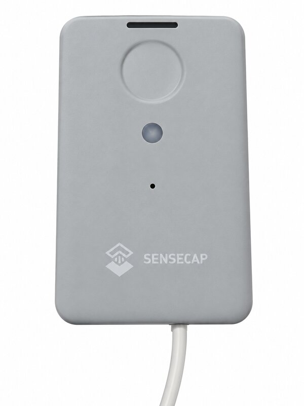

# T1000A — MeshCore sur le SenseCAP T1000-A (Goodix GR5515)

<p align="center"></p>

Portage de MeshCore sur le SenseCAP T1000-A de Seeed (GR5515 + LR1110 + AG3335). Le boîtier n'a ni USB ni
SWD : on le flashe en BLE par le bootloader Seeed, et chaque firmware passe d'abord par un jumeau numérique
du boîtier.

Ce dépôt est la **racine d'intégration** : chaque composant vit dans son propre dépôt, monté ici en sous-module à
la révision qui a été testée avec les autres.

## Démarrage depuis un clone neuf

```
git clone --recurse-submodules https://github.com/Artemia76/T1000A.git && cd T1000A
tools/setup.sh                    # sous-modules, push en ssh vers Artemia76, .venv (PlatformIO, jumeau, bleak)
```

Puis :

| Cible | Commande |
|---|---|
| Firmware MeshCore compagnon BLE | `cd firmware/meshcore && ../../.venv/bin/pio run -e t1000a_companion_radio_ble` |
| Exemple blink de la plateforme | `cd platform/gr551x/examples/blink && ../../../../.venv/bin/pio run` |
| Firmware de test hello (GCC système) | `make -C firmware/hello` |
| Tests du jumeau numérique | `cd emulator/twin && ../../.venv/bin/python -m pytest -q tests` |
| Flash BLE (refusé si le jumeau échoue) | `.venv/bin/python tools/t1000_ble.py flash <image>_dfu.bin` |
| Rebase du fork MeshCore sur l'amont | `tools/sync-upstream.sh [--local]` |

## Contenu

| Dossier | Nature | Rôle |
|---|---|---|
| `firmware/meshcore/` | sous-module, [fork MeshCore](https://github.com/Artemia76/MeshCore) (`feature/t1000a-gr5515`) | Firmware MeshCore, variante `t1000-a` |
| `firmware/hello/` | versionné ici | Firmware de test et de diagnostic (Makefile, SDK direct) |
| `platform/gr551x/` | sous-module, [platform-gr551x](https://github.com/Artemia76/platform-gr551x) | Plateforme PlatformIO + cœur Arduino GR551x, outils BLE/DFU |
| `emulator/twin/` | sous-module, [t1000a-twin](https://github.com/Artemia76/t1000a-twin) | Jumeau numérique du T1000-A et ses tests |
| `third_party/gr551x-sdk/` | sous-module, [fork du SDK Goodix](https://github.com/Artemia76/GR551x.SDK) (`platformio`) | SDK du GR551x (hello, symboles ROM du jumeau) |
| `third_party/radiolib/` | sous-module, [RadioLib](https://github.com/jgromes/RadioLib) | Pilote LR1110 (hello) |
| `third_party/goodix-dfu-android/` | sous-module non initialisé par défaut | Référence du protocole DFU Goodix |
| `tools/` | versionné ici | `setup.sh`, `sync-upstream.sh`, `ci-build.sh`, `ci-issue.sh`, `meshcore_ble.py` ; `t1000_ble.py` et `mkimage.py` sont des liens symboliques vers `platform/gr551x/tools/` |
| `docs/` | versionné ici | Matériel du T1000-A relevé par rétro-ingénierie |

Règle de rangement : `firmware/`, `platform/` et `emulator/` contiennent nos composants, `third_party/` le code des
autres, forké ou non.

## Travailler sur un composant

Un sous-module est un dépôt complet : on y crée une branche, on commite et on pousse comme d'habitude, puis on
enregistre la nouvelle révision dans T1000A.

```
cd platform/gr551x && git switch main && …        # modifier, commiter, git push
cd ../.. && git add platform/gr551x && git commit -m "platform : …"
git submodule update --remote firmware/meshcore    # suivre la branche déclarée dans .gitmodules
```

## Maintenance automatique

| Mécanisme | Où | Ce qu'il fait |
|---|---|---|
| CI (`.github/workflows/ci.yml`) | push sur `main`, PR | `tools/ci-build.sh` : cohérence SDK sous-module / `platform.json`, MeshCore avec la plateforme du sous-module, blink, hello, jumeau numérique. Rejouable en local |
| Dependabot (`.github/dependabot.yml`) | chaque lundi | Une PR par sous-module qui a avancé (MeshCore, plateforme, jumeau, RadioLib), validée par la CI ; actions GitHub chaque mois |
| Amont (`.github/workflows/upstream-watch.yml`) | chaque lundi | MeshCore `dev` a avancé : rebase du fork, compilation, jumeau, puis issue « Amont : MeshCore dev » avec le résultat. Nouveaux commits Goodix : issue « Amont : SDK Goodix » |
| ArduinoCore-API (workflow de la plateforme) | chaque mois | Copie de `cores/gr551x/api` refaite avec nos patchs, blink compilé, PR dans platform-gr551x |

Le workflow Amont pousse le résultat du rebase sur une branche `auto/rebase-AAAAMMJJ` du fork si le secret
`MESHCORE_FORK_TOKEN` (jeton à droit d'écriture sur Artemia76/MeshCore) est défini ; il ne touche jamais à
`feature/t1000a-gr5515`.
